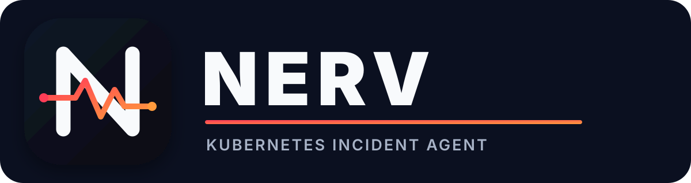

<p align="center">
  
</p>

<p align="center">
  Durable incident investigation for Kubernetes.
</p>

NERV runs inside a cluster, accepts questions and alerts, autonomously detects sustained Kubernetes failures, gathers evidence, and records each investigation in PostgreSQL. DBOS checkpoints the workflow so it can resume after a restart instead of repeating completed work.

NERV is read-only. It can inspect workloads and notify an operator, but it cannot change cluster resources.

## How it works

NERV starts the same investigation workflow from two inputs:

- `POST /ask` for operator questions
- `POST /alert` for Alertmanager-compatible webhooks
- client-go informers for sustained Pod and workload failures
- the embedded private operator UI at `/ui/`

For non-suppressed work, bounded durable agent loop lets model discover workloads and choose approved typed read-only tools for status, events, logs, owner chains, and nodes. Operator questions receive local `investigate` decision; alerts and autonomous detections use Decision Gateway to choose whether to suppress, investigate, research, or escalate. Every model round and tool execution is separate DBOS checkpoint. NERV persists executed evidence, structured finding, budget accounting, and Gotify notification.

```text
question or alert
       |
       v
  DBOS workflow ------> PostgreSQL
       |
       +----> Kubernetes API
       +----> Decision Gateway
       +----> Agentgateway
       +----> Gotify
```

See [docs/architecture.md](docs/architecture.md) for workflow and component details.

## Local Kubernetes test

The local stack runs in Docker Desktop Kubernetes. It includes ephemeral PostgreSQL and uses the echo provider, so it does not call Agentgateway, Decision Gateway, or Gotify.

```bash
task local:up
task local:smoke
task local:recovery
```

These tasks target the `docker-desktop` context explicitly and refuse the `homelab` context.

```bash
task local:logs
task local:down
```

Use another disposable cluster with:

```bash
task local:up KUBE_CONTEXT=kind-nerv
```

Full instructions: [docs/local-kubernetes.md](docs/local-kubernetes.md).

## Run from the host

Start PostgreSQL in Docker, then run NERV against the Kubernetes context in your local kubeconfig:

```bash
cp .env.example .env
set -a; source .env; set +a

task db:up
task run:serve
```

Open `http://127.0.0.1:8080/ui/`, enter the `NERV_AUTH_TOKEN`, then browse incidents or submit a question. The UI keeps the token in browser `sessionStorage` for at most 30 minutes and calls NERV HTTP APIs; it never connects directly to PostgreSQL, Kubernetes, SigNoz, or ClickHouse.

Ask about a pod from the CLI:

```bash
go run ./cmd/nerv ask \
  --namespace default \
  --kind pod \
  --name my-pod \
  "why is this pod restarting?"
```

The local environment uses the echo provider unless you configure cluster AI services.

## API

| Route | Behavior |
| --- | --- |
| `GET /healthz` | Process liveness |
| `GET /readyz` | PostgreSQL readiness |
| `POST /ask` | Run an investigation and return the finding |
| `POST /alert` | Durably accept alerts and return workflow IDs |
| `GET /investigations` | List incident history with bounded pagination and filters |
| `GET /investigations/{id}` | Return incident metadata, status, finding, evidence, and notifications |
| `GET /ui/` | Embedded operator UI shell (API calls still require bearer authentication) |

Request examples and response fields: [docs/api.md](docs/api.md).

Environment variables and service addresses: [docs/configuration.md](docs/configuration.md).

## Deployment

The base manifests live in `deploy/base`. `deploy/local` adds ephemeral PostgreSQL and local-only configuration.

```bash
task deploy:build
task deploy:diff
```

Before deploying to a shared cluster:

1. Build and publish the NERV image.
2. Create a dedicated PostgreSQL database and user.
3. Replace `deploy/base/secret.example.yaml` with Vault and External Secrets configuration.
4. Set the Gotify application token.
5. Confirm Agentgateway, Decision Gateway, PostgreSQL, Gotify, and OTLP service addresses.

Do not apply the example secret to a shared cluster.

## Development

```bash
task test
task vet
task docker:build
```

Project layout:

```text
cmd/nerv/             CLI and HTTP server
internal/api/         HTTP routes and authentication
internal/investigation/ DBOS workflow
internal/kubernetes/  read-only Kubernetes tools
internal/decision/    Decision Gateway client
internal/llm/         Agentgateway and echo providers
internal/notify/      Gotify client
internal/store/       PostgreSQL records and migrations
deploy/base/          shared Kubernetes manifests
deploy/local/         disposable local cluster overlay
docs/                 architecture, API, and testing notes
```

## Guardrails

- Kubernetes access is read-only.
- Tools use `client-go`; NERV does not execute shell commands.
- Agent rounds, tool calls, tokens, time, concurrency, logs, evidence, and tool output have validated limits.
- Logs, events, status messages, and annotations are treated as untrusted input.
- Agentgateway fallback is disabled unless `NERV_LLM_FALLBACK_MODEL` is explicitly configured, and only retryable primary provider/transport failures qualify.
- GenAI telemetry records operation, tool, budget, model, finish, and token metadata—not prompts, evidence, model output, or tool payloads.
- API routes require bearer authentication when `NERV_AUTH_TOKEN` is set. Configure it for every private or shared deployment.
- Operator UI stores bearer token in per-tab `sessionStorage` with a 30-minute expiry; token is never embedded in served HTML or JavaScript.
- NERV has no public ingress in the base manifests.
- Remediation is deferred until investigation quality and approval controls are tested.

Gotify, PostgreSQL, and NERV share the cluster failure domain. A total cluster outage needs an external monitor and an out-of-band notification path.

## License

[MIT](LICENSE)
